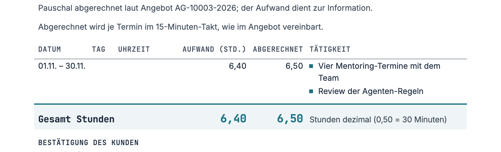
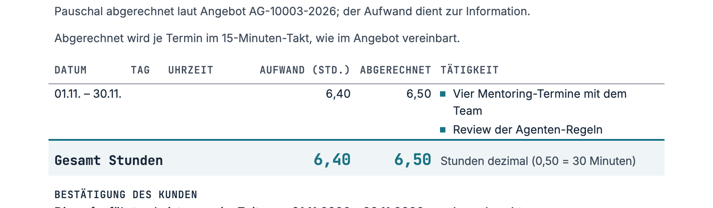

# The space under a list in a table cell, and where an item's 1 pt goes, 11.11.2026

c shipped in v1.29.0, as a top margin on `li + li` (see [Shipped](#shipped-in-v1290)). The panel
itself scored no variant ahead of today's lists outside its noise, and its own rule shipped
nothing; the blind-review skill gives such a tie to the variant with fewer exceptions, which is c.
This report holds the readings and the scores. It follows up the two points left open in
[the timesheet baseline report](2026-11-11-timesheet-list-baseline.md).

## Variants

| Variant | Change in `document.css`                                                                                                                                                                                                                                                |
| ------- | ----------------------------------------------------------------------------------------------------------------------------------------------------------------------------------------------------------------------------------------------------------------------- |
| a       | none (v1.28.1)                                                                                                                                                                                                                                                          |
| b       | a list that is a cell's last element loses its bottom margin and its last item's bottom padding                                                                                                                                                                         |
| c       | items lose their 1 pt above and below. The 2 pt between two items, today's gap, moves to `li + li`. The v1.28.1 rule for the first item in a cell goes, and `scripts/onepager.ts` takes the `li + li` rule beside `ul li`. Without it, the onepager's items would touch |
| d       | b and c together                                                                                                                                                                                                                                                        |

## Readings

Print media, 794 px wide, on the type pages in `dist/types/`. A gap runs from text box to text box.

**Under a list in a cell.** The test's copied rows were used: plain wrapped text against a wrapped
list in the same cell.

| Page                                                                 | Plain text | a     | b     | c     | d     |
| -------------------------------------------------------------------- | ---------- | ----- | ----- | ----- | ----- |
| timesheets (month, training)                                         | 3.25       | 12.58 | 3.25  | 11.25 | 3.25  |
| flat-fee timesheet                                                   | 3.75       | 12.58 | 3.25  | 11.25 | 3.25  |
| quote without prices, delivery briefing, Markdown document, elements | 9.16       | 18.48 | 9.16  | 17.16 | 9.16  |
| handout                                                              | 10.14      | 19.47 | 10.14 | 18.14 | 10.14 |
| flat-fee timesheet, its own row                                      | 3.75       | 13.08 | 3.75  | 11.75 | 3.75  |

In a, the list adds 9.33 px (7 pt: 6 pt margin, 1 pt padding) wherever plain text and list share
the reference. On the flat-fee timesheet the copied list ends 0.5 px closer to the cell's bottom
than the copied plain text and than the page's own list row, so there it adds 8.83 px, and in b and
d it sits 0.5 px tighter than plain text. That 0.5 px is not explained. The earlier report read
10.33 against 0.76 px from another reference point; the 0.24 px between its difference and 9.33 is
not explained either. In every variant each copied list starts where plain text in its cell does.

**Lists outside tables.** In c and d, a list after a paragraph sits 11.31 px below it. That is the
gap between two paragraphs (a: 12.64). After a heading the gap goes from 9.33 to 8 px. The gap
between items stays at 5.97 px. Lists with their own item spacing do not change: DocSteps' timeline
and the handout's contents. The certificate's topics list is 2.66 px shorter.

**PDF pages.** One PDF per type, rendered from each build; the survey readout, which does not sit
on the document base, was not rendered. No type changed its page count under
any variant, and every page kept the same text, so no page break moved. In b, only the flat-fee
timesheet and the elements page change at all. In c and d, every type with a list in the base's
style changes by 1 to 3 px per list. That is every type except the handout, the order confirmation,
the preparation and the month and training timesheets.

## Blind panel

Three crops at scale 2, full A4 width: the flat-fee timesheet's list row with the total below, the
quote's two service cards and the NDA's clause 1 with its list. b and d render the same timesheet,
and a and b render the same cards and clause. Each distinct render was shown once, under a neutral
label in a shuffled order. Three personas (a controller who signs off timesheets, an editorial
designer, an engineering lead receiving quotes) on Claude Opus 5.5 at medium effort and Codex
gpt-6.1-sol at high effort, two runs each. A variant's score is the mean of its three views'
overall scores (1 to 10). Noise is the mean change between a reviewer's two runs.

Criteria, fixed before any score: balance (the list sits evenly in its row or box, neither
top-heavy nor bottom-heavy), room (breathing room, not cramped), calm (an even, consistent spacing
rhythm), grouping (the list reads as part of what introduces it and apart from what follows), and
overall (which you would rather receive). The designer's first run got this prompt:

> You are an editorial designer who sets business print documents (reports, contracts, invoices)
> and judges spacing and typographic rhythm for a living.
>
> You are shown crops of A4 business documents (German text) from the same consultancy. Medium: an
> A4 PDF read on a laptop at about 100-125 % zoom and also printed. Display size: each image shows
> the full 210 mm page width at double pixel density (1588 px = 210 mm), cropped vertically. Within
> each group the images show the same content set in different ways; judge only how they look.
> Open each image with the Read tool (where images are attached, they come in the order listed
> here, groups in this order too):
>
> - A quote: two service cards, each with a bullet list: /tmp/dls/panel/cards-j.png,
>   /tmp/dls/panel/cards-v.png
> - An NDA: a clause whose paragraph introduces a bullet list, then the next clause:
>   /tmp/dls/panel/clause-f.png, /tmp/dls/panel/clause-s.png
> - A timesheet: the table row listing the activities, with the total row below:
>   /tmp/dls/panel/row-q.png, /tmp/dls/panel/row-m.png, /tmp/dls/panel/row-h.png
>
> Score every image from 1 to 10 on each criterion: 1. balance: the list sits evenly in its row or
> box, neither top-heavy nor bottom-heavy 2. room: breathing room, not cramped 3. calm: visual calm,
> an even and consistent spacing rhythm 4. grouping: the list reads as part of what introduces it
> and apart from what follows 5. overall: which you would rather receive
>
> For each image and each criterion below 10, say in a few words what keeps it there. Compare
> images only within their group. End your answer with one JSON line, nothing after it: (the score
> object, one entry per label)

| Model  | Noise | Run | a    | b            | c            | d            |
| ------ | ----- | --- | ---- | ------------ | ------------ | ------------ |
| Claude | 0.56  | 1   | 8.22 | 7.78 (−0.44) | 8.44 (+0.22) | 8.00 (−0.22) |
| Claude | 0.56  | 2   | 8.33 | 7.22 (−1.11) | 8.00 (−0.33) | 7.11 (−1.22) |
| Codex  | 0.08  | 1   | 8.78 | 8.56 (−0.22) | 9.00 (+0.22) | 8.67 (−0.11) |
| Codex  | 0.08  | 2   | 9.00 | 8.67 (−0.33) | 9.00 (0.00)  | 8.67 (−0.33) |

The rule, fixed before scoring, was: a variant ships only where its lead over a exceeds the noise
in both runs and with both models. None does. c leads in one Codex run only. b and d lose because
of the timesheet row. There the reviewers read the last item as pressed against the total row's
rule: room 6.33 against 9.0 for a. On balance, though, b and d score highest (8.25 against 7.92).
So the space under the list does make the row ride high, and it is also the only room before the
total.

| a, today                                | b and d                                        | c                                               |
| --------------------------------------- | ---------------------------------------------- | ----------------------------------------------- |
|  |  |  |

A variant that might beat a has not been built: it would close the gap under a list only where
another body row follows, not a total. The sample has a single row, so it shows the total case
alone.

Review: medium, because the change would reach every client document while one rule was in question.

## Shipped in v1.29.0

`document.css` drops the items' 1 pt above and below and the v1.28.1 rule for a list first in a
cell; `li + li` takes a top margin of 2 pt, today's gap. The onepager takes that rule beside
`ul li`.

**Margin, not padding.** The panel scored c with the 2 pt as padding. As padding, the second and
third columns of the proposal's three-column list of what is included start 2.66 px below the
first, since every item but the first carries it. A margin falls away at a column break, so all
three start level. On every other list of every type page both forms measure the same: list
height, space above and below, the gaps between items. The panel's three crops hold no
multi-column list, so its scores stand for the margin form.

**Lists with their own spacing.** A margin also reaches lists whose component pads its items
itself. The timeline (DocSteps' and the base's own `.timeline`) and the handout's contents set
`margin: 0` and stay as they were, and so does the onepager's client row. The certificate's compact topic list moves to the same form, 0.6 mm
between items, and its tight fit takes that to 0.

**What changes besides the edges.** In a loose Markdown list, where each item is a paragraph, the
paragraph's 6 pt margin and the 2 pt between items now overlap instead of adding up: 6 pt between
two items instead of 8 pt, text to text 11.31 px instead of 13.97. The last paragraph's margin now
falls through the list's bottom too, so the text after a loose list follows as after a tight one
(10.31 px from its last line instead of 19.64). Items around a nested list close up the same way
(11.31 px instead of 15.30). No sample holds a loose or a nested list; these readings come from
lists added to the type pages.

**PDF pages**, one per type, rendered before and after: no page count changed and every page kept
its text. The end of the body text moved on these pages:

| Type                                    | Page | Body text ends |
| --------------------------------------- | ---- | -------------- |
| proposal, without prices, signed, quote | 2    | 3.75 pt higher |
| onepager (sample and its fit)           | 1    | 3.75 pt higher |
| onepager (sample and its fit)           | 2    | 1.50 pt higher |
| NDA                                     | 1    | 2.25 pt higher |
| rate card                               | 1    | 2.25 pt higher |
| Markdown document                       | 1    | 2.25 pt higher |
| delivery briefing                       | 1    | 1.50 pt higher |
| flat-fee timesheet                      | 1    | 0.75 pt higher |
| trainer briefing                        | 1    | 0.75 pt higher |

The certificate's words shift by up to 1.5 pt within its fixed page. The onepager's fit stays at page
2 starting at block 8, lift 2, air 4. The handout, the order confirmation, the preparation, the
month and training timesheets, the elements page and the survey readout print as before.
