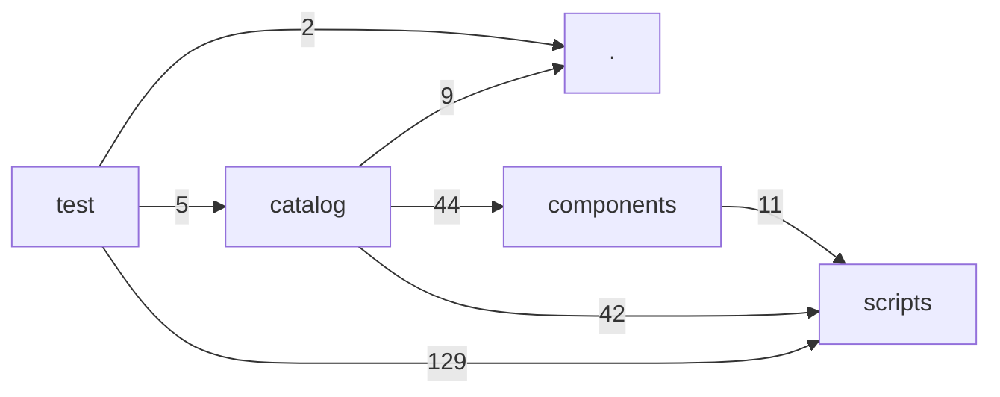

# Layers

## scripts

| Forbidden import                                                                          | Message                                                                                                                                                                                                                                                                                |
| ----------------------------------------------------------------------------------------- | -------------------------------------------------------------------------------------------------------------------------------------------------------------------------------------------------------------------------------------------------------------------------------------- |
| `^(?:(?:\.\./)+(?:components\|catalog)\|@hackersandwizards/documents/components)(?:/\|$)` | `scripts/** cannot import from components/, catalog/, or @hackersandwizards/documents/components. Move shared types, helpers, or sample data into scripts/ (such as scripts/samples.ts), or render components via scripts/compose.ts or catalog/. Do not silence with oxlint-disable.` |
